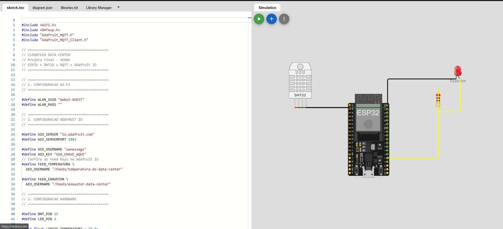
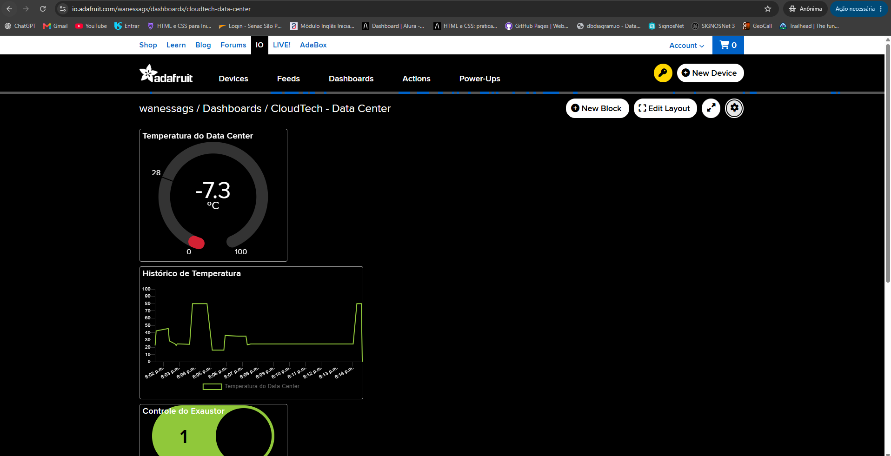
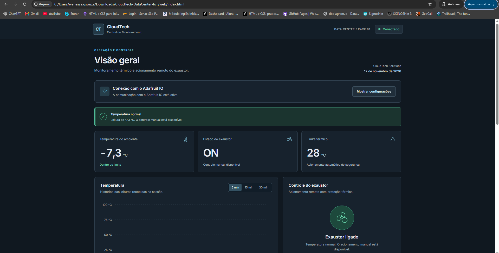

# CloudTech Data Center IoT

Sistema de monitoramento térmico e controle de exaustão para um Data Center, desenvolvido como projeto final da disciplina de Cloud Computing e Internet das Coisas (IoT), no SENAC.

O projeto integra um ESP32 simulado no Wokwi, um sensor DHT22, a plataforma Adafruit IO e uma interface web própria para acompanhar a temperatura e controlar o sistema de exaustão.

## Integrantes

- Felipe Freita
- Francisco Arthur
- Wanessa Gonçalves

**Curso:** Tecnologia em Sistemas para Internet (TSI)  
**Instituição:** SENAC  
**Ano:** 2026

---

## 1. Objetivo

Desenvolver uma solução de monitoramento de temperatura para um ambiente de Data Center, utilizando conceitos de Internet das Coisas, computação em nuvem e Edge Computing.

O sistema permite acompanhar as leituras de temperatura remotamente, controlar um exaustor simulado e executar ações automáticas de proteção quando a temperatura atinge um limite de segurança.

## 2. Tecnologias utilizadas

| Tecnologia | Aplicação |
|---|---|
| ESP32 | Processamento local e controle do exaustor |
| DHT22 | Leitura de temperatura |
| Wokwi | Simulação do circuito eletrônico |
| Adafruit IO | Recebimento e disponibilização dos dados |
| MQTT | Comunicação entre o ESP32 e a plataforma |
| HTML5 | Estrutura da interface web |
| CSS3 | Estilização e responsividade |
| JavaScript | Atualização dos indicadores e comandos |
| MQTT.js | Comunicação MQTT no navegador |
| Git e GitHub | Versionamento e publicação do código |

## 3. Arquitetura do sistema

A comunicação entre os componentes é realizada por meio do Adafruit IO.

```text
                 WOKWI
          ESP32 + Sensor DHT22
                  |
                  | Wi-Fi / MQTT
                  |
                  v
              ADAFRUIT IO
         ---------------------
         Feed de temperatura
         Feed do exaustor
         ---------------------
                  |
          MQTT / WebSocket
                  |
                  v
           INTERFACE WEB
       HTML + CSS + JavaScript
```

O ESP32 publica as leituras de temperatura no Adafruit IO e recebe comandos relacionados ao exaustor.

A interface web utiliza os mesmos feeds para apresentar as informações e permitir o acionamento remoto.

O Dashboard nativo do Adafruit IO também permite acompanhar os dados.

## 4. Funcionamento

### 4.1. Leitura da temperatura

O sensor DHT22 é responsável pela leitura da temperatura do ambiente.

O ESP32 realiza verificações periódicas e publica os dados no Adafruit IO, permitindo o acompanhamento pelas interfaces de monitoramento.

### 4.2. Controle automático

O limite de segurança foi definido em **28 °C**.

Quando a temperatura atinge ou ultrapassa esse valor:

1. O ESP32 identifica a condição de emergência térmica.
2. O exaustor simulado é ligado automaticamente.
3. O estado do exaustor é publicado no Adafruit IO.
4. A interface web apresenta o alerta de temperatura elevada.
5. O desligamento manual é bloqueado por segurança.

Quando a temperatura retorna a um valor inferior a 28 °C após uma emergência, o firmware desliga automaticamente o exaustor e publica a mudança de estado.

### 4.3. Controle manual

Em condições normais de temperatura, o usuário pode solicitar o acionamento ou desligamento do exaustor pela interface web.

Os comandos são transmitidos ao Adafruit IO, de onde são recebidos pelo ESP32.

A validação do limite térmico é realizada diretamente no firmware, independentemente da interface utilizada.

### 4.4. Edge Computing

A lógica de proteção térmica é executada no ESP32.

Isso permite que a decisão de ligar o exaustor seja tomada localmente, com base na leitura do sensor, sem depender de um comando enviado pelo Dashboard.

A comunicação com a nuvem é utilizada para monitoramento, sincronização dos estados e controle remoto.

## 5. Configuração do hardware

| Componente | Conexão |
|---|---|
| ESP32 | Microcontrolador principal |
| DHT22 | GPIO 15 |
| LED | GPIO 2 |
| Resistor | 220 Ω, em série com o LED |

O LED representa o funcionamento do exaustor no circuito simulado.

O projeto utiliza o ambiente Wokwi para executar o firmware e testar as condições de operação.

## 6. Configuração do Adafruit IO

A solução utiliza dois feeds:

| Feed | Finalidade |
|---|---|
| `temperatura-do-data-center` | Armazenar e disponibilizar as leituras de temperatura |
| `exaustor-data-center` | Enviar comandos e acompanhar o estado informado do exaustor |

**Usuário Adafruit IO:** `wanessags`

### Comunicação MQTT

O ESP32 utiliza:

- Servidor: `io.adafruit.com`
- Porta: `1883`
- Protocolo: MQTT

A interface web utiliza:

- Servidor: `wss://io.adafruit.com:443`
- Protocolo: MQTT sobre WebSocket seguro (WSS)

A diferença ocorre porque o navegador utiliza WebSocket para estabelecer a comunicação MQTT.

## 7. Interface web

A interface foi desenvolvida com HTML, CSS e JavaScript, sem a necessidade de um framework de front-end.

### Funcionalidades

- Exibição da temperatura recebida do Adafruit IO.
- Indicação do estado do exaustor.
- Visualização do limite térmico de segurança.
- Gráfico das leituras de temperatura.
- Seleção do período apresentado no gráfico.
- Acionamento e desligamento remoto do exaustor.
- Bloqueio de desligamento em condição de emergência.
- Notificações de conexão, comandos e alertas.
- Histórico de eventos com filtros.
- Configurações de conexão recolhíveis.
- Layout responsivo para computadores e dispositivos móveis.

### Arquivos

- `index.html`: estrutura da interface.
- `style.css`: estilos e responsividade.
- `script.js`: comunicação MQTT, indicadores, gráfico e controles.

### Como executar

1. Baixe ou clone este repositório.
2. Abra um terminal na pasta principal do projeto.
3. Inicie um servidor HTTP local para a pasta `web`.
4. Abra o endereço do servidor no navegador.
5. Informe uma AIO Key válida na interface.
6. Clique em **Conectar**.

Exemplo de execução com Node.js:

```bash
npx --yes http-server web -p 5500 -c-1
```

Depois, acesse:

```text
http://localhost:5500
```

A interface depende de conexão com a internet para acessar o Adafruit IO e carregar a biblioteca MQTT.js.

## 8. Executando o firmware no Wokwi

O projeto utiliza as bibliotecas:

- WiFi
- DHTesp
- Adafruit MQTT Library

Para executar uma simulação funcional:

1. Abra o projeto no Wokwi.
2. Confira as conexões do circuito.
3. Insira uma AIO Key válida em uma cópia privada do firmware.
4. Inicie a simulação.
5. Acompanhe as mensagens no Serial Monitor.
6. Altere a temperatura do sensor DHT22 para testar o comportamento.

### Testes sugeridos

| Cenário | Resultado esperado |
|---|---|
| Temperatura abaixo de 28 °C | Controle manual disponível |
| Comando para ligar | LED ligado |
| Comando para desligar abaixo de 28 °C | LED desligado |
| Temperatura igual ou superior a 28 °C | LED ligado automaticamente |
| Desligamento durante emergência | Comando bloqueado pelo ESP32 |
| Temperatura normalizada após emergência | Desligamento automático |
| Alteração de temperatura | Nova leitura publicada no Adafruit IO |

## 9. Segurança

As credenciais de acesso ao Adafruit IO não devem ser incluídas no repositório público.

A versão publicada do firmware utiliza um valor de exemplo:

```cpp
#define AIO_KEY "SUA_CHAVE_AQUI"
```

Para realizar os testes, a chave deve ser informada apenas em uma cópia privada do projeto.

Na interface web, a chave é fornecida pelo usuário durante a conexão. O projeto não utiliza armazenamento local do navegador para guardar essa credencial.

**Observação:** enquanto a conexão estiver ativa, a chave permanece na memória do cliente MQTT. Portanto, a interface deve ser utilizada em um ambiente confiável.

O projeto público do Wokwi não realiza a conexão ao Adafruit IO sem uma chave válida.

## 10. Estrutura do repositório

```text
CloudTech-DataCenter-IoT/
|
|-- firmware/
|   |-- sketch.ino
|   |-- diagram.json
|   `-- libraries.txt
|
|-- web/
|   |-- index.html
|   |-- style.css
|   `-- script.js
|
|-- docs/
|   `-- evidencias/
|
|-- evidencias/
|   |-- worwi.png
|   |-- androidio.png
|   `-- interface-web.png
|
|-- links.txt
`-- README.md
```

## 11. Links do projeto

**Simulação no Wokwi:**  
https://wokwi.com/projects/480530038993558529

**Dashboard no Adafruit IO:**  
Consultar o endereço público no arquivo `links.txt`.

**Código-fonte no GitHub:**  
https://github.com/wanessags/CloudTech-DataCenter-IoT

## 12. Evidências

### Circuito no Wokwi



### Dashboard nativo do Adafruit IO



### Interface web CloudTech



As evidências demonstram as interfaces utilizadas no monitoramento e controle do sistema.

## 13. Considerações finais

O projeto CloudTech Data Center IoT demonstra a integração entre dispositivos IoT, computação em nuvem e desenvolvimento web.

A solução realiza a leitura de temperatura, disponibiliza os dados por meio do Adafruit IO e permite o controle remoto de um exaustor simulado.

O uso de Edge Computing mantém a lógica de proteção térmica no ESP32, enquanto a interface web facilita o acompanhamento das condições do ambiente.

A implementação permite explorar conceitos de automação, comunicação MQTT, monitoramento remoto e segurança operacional.

---

**CloudTech Data Center IoT**  
Projeto Final — SENAC, 2026

Felipe Freita · Francisco Arthur · Wanessa Gonçalves
